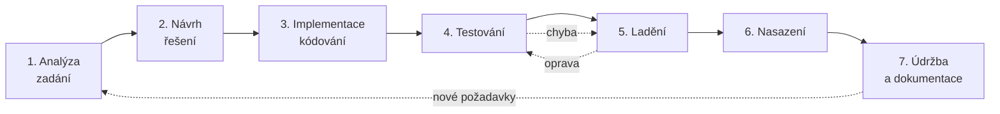
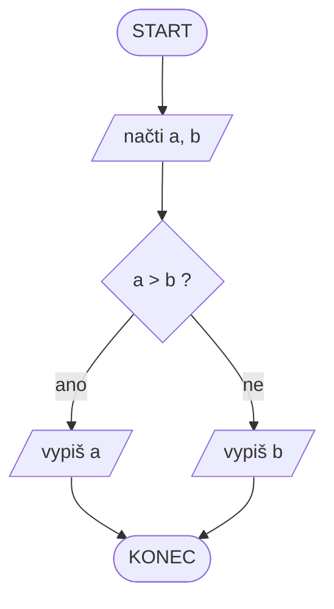

# 1. Algoritmizace

> **Maturitní otázka č. 1 – Programování a vývoj aplikací** (obor 18-20-M/01 Informační technologie, školní rok 2026/2027)
>
> **Zadání:** fáze vzniku programu, způsoby zápisu programu, algoritmus a jeho vlastnosti, pojmy ladění, testování, sémantika, syntaxe, rekurze.

## Obsah

1. [Fáze vzniku programu](#1-fáze-vzniku-programu)
2. [Způsoby zápisu programu](#2-způsoby-zápisu-programu)
3. [Algoritmus a jeho vlastnosti](#3-algoritmus-a-jeho-vlastnosti)
4. [Syntaxe a sémantika](#4-syntaxe-a-sémantika)
5. [Testování](#5-testování)
6. [Ladění](#6-ladění)
7. [Rekurze](#7-rekurze)
8. [Rychlé shrnutí na 1 minutu](#8-rychlé-shrnutí-na-1-minutu)
9. [Možné doplňující otázky](#9-možné-doplňující-otázky)

---

## 1. Fáze vzniku programu

Program nevzniká tím, že si sednu a začnu psát kód. Má jasné fáze (tzv. **životní cyklus vývoje**):



| Fáze | Co se v ní děje | Výstup |
|---|---|---|
| **1. Analýza** | Zjistím, *co* má program dělat: požadavky zákazníka, vstupy, výstupy, omezení. | Specifikace / zadání |
| **2. Návrh** | Navrhnu, *jak* to bude fungovat: algoritmus, datové struktury, rozdělení na moduly, vzhled UI, databáze. | Vývojový diagram, pseudokód, UML |
| **3. Implementace** | Návrh zapíšu v programovacím jazyce. | Zdrojový kód |
| **4. Testování** | Ověřím, zda program dělá to, co má (hledám chyby). | Seznam nalezených chyb |
| **5. Ladění** | Nalezené chyby opravím (zjistím příčinu a odstraním ji). | Opravený program |
| **6. Nasazení** | Předání uživateli, instalace, provoz. | Fungující produkt |
| **7. Údržba** | Opravy, úpravy, nové funkce, aktualizace, dokumentace. | Nové verze |

**Od zdrojového kódu ke spuštění:**
`zdrojový kód` → **překlad** (kompilátor / interpret) → `strojový kód` (nebo bytecode) → **spuštění** procesorem / virtuálním strojem.

**Poznámky k fázím**
- Čím později se chyba najde, tím je její oprava **dražší** (chyba v analýze je nejdražší).
- Fáze se v praxi **opakují** (iterativně) – to je základ agilních metodik (viz otázka 19). Dříve se používal **vodopádový model** (fáze jdou po sobě a nevrací se).

---

## 2. Způsoby zápisu programu

Algoritmus nejdřív zapisuji **nezávisle na jazyce** a až potom ho převedu do kódu.

| Způsob zápisu | Popis | Výhody / nevýhody |
|---|---|---|
| **Slovní popis** | Postup popsaný větami v českém jazyce, nejčastěji číslované kroky. | + jednoduché, srozumitelné<br/>− nejednoznačné, nepřesné u složitých úloh |
| **Vývojový diagram** | Grafický zápis pomocí normovaných značek a šipek. | + přehledný, názorný<br/>− u velkých programů nepřehledný, pracné kreslení |
| **Pseudokód** | Zápis „jako programovací jazyk“, ale bez přísné syntaxe. | + blízko kódu, rychlé<br/>− nemá jednotný standard |
| **Strukturogram** (Nassi–Shneidermanův diagram) | Diagram z vnořených obdélníků, bez šipek, odpovídá strukturovanému programování. | + nelze „skákat“ (žádné goto)<br/>− méně známý |
| **Programovací jazyk** | Konečný zápis, který se dá přeložit a spustit. | + přesný a spustitelný<br/>− nutná znalost jazyka |
| **UML diagram aktivit** | Standardizovaný diagram pro modelování procesů (používá se spíš u větších systémů). | + standard, srozumitelný týmům |
| **Rozhodovací tabulka** | Tabulka podmínek a z nich vyplývajících akcí. | + dobré pro složité podmínky |

### Značky vývojového diagramu

| Značka | Tvar | Význam |
|---|---|---|
| Začátek / konec | zaoblený obdélník (ovál) | START, STOP |
| Zpracování (příkaz) | obdélník | přiřazení, výpočet |
| Vstup / výstup | rovnoběžník | `načti`, `vypiš` |
| Podmínka (rozhodnutí) | kosočtverec | ano / ne, 2 výstupy |
| Spojka | kroužek | napojení na jiné místo diagramu |
| Šipka | čára se šipkou | směr toku řízení |
| Podprogram | obdélník s dvojitými boky | volání funkce |

### Ukázka – největší ze dvou čísel

**Vývojový diagram** (GitHub ho vykreslí sám):



**Pseudokód:**

```text
ZAČÁTEK
    načti a, b
    POKUD a > b
        vypiš a
    JINAK
        vypiš b
KONEC
```

**Python:**

```python
a = int(input())
b = int(input())
print(a if a > b else b)
```

### Základní řídicí struktury (strukturované programování)

Každý algoritmus jde sestavit jen ze **tří** konstrukcí:

1. **Sekvence** – příkazy za sebou.
2. **Větvení (selekce)** – `if`, `if-else`, `switch`/`match`.
3. **Cyklus (iterace)** – `while`, `do-while`, `for`, `foreach`.

(Příkaz `goto` se nepoužívá – zhoršuje čitelnost, vzniká „špagetový kód“.)

---

## 3. Algoritmus a jeho vlastnosti

> **Algoritmus** je **konečná posloupnost jednoznačně určených kroků** (příkazů), která vede od **vstupních dat** k **výstupním datům** a řeší určitý typ úlohy.
>
> Název pochází od perského matematika **al-Chwárizmího** (9. století).

### Vlastnosti algoritmu (přehled)

| Vlastnost | Co znamená | Příklad porušení |
|---|---|---|
| **Konečnost** | Skončí po konečném počtu kroků. | `while True: pass` – nekonečný cyklus |
| **Determinismus** (jednoznačnost) | Každý krok je přesně určen; při stejném vstupu je stejný postup i výsledek. | „Přidej trochu soli.“ |
| **Obecnost** (hromadnost) | Řeší celou *třídu* úloh pro různé vstupy, ne jen jeden konkrétní případ. | Program umí sečíst jen `2 + 3` |
| **Rezultativnost** (výstup) | Vždy vrátí nějaký výsledek (alespoň jeden výstup). | Algoritmus nic nevrátí ani nevypíše |
| **Elementárnost** (srozumitelnost) | Skládá se z jednoduchých, proveditelných kroků. | „Vyřeš to nějak.“ |
| **Efektivita** (účinnost) | Spotřebuje rozumně času a paměti. | Hledání v seřazeném poli prochází vše |
| **Opakovatelnost** | Lze ho opakovaně provést se stejným výsledkem. | – |

> **Co si zapamatovat:** *konečnost, determinismus, obecnost, rezultativnost, elementárnost.* (Zbytek jsou doplňky podle zdroje.)

### Složitost algoritmu (stručně)

- **Časová složitost** – kolik kroků algoritmus udělá v závislosti na velikosti vstupu *n*.
- **Prostorová složitost** – kolik paměti potřebuje.
- Zapisuje se **notací velké O** (nejhorší případ):

| Zápis | Název | Příklad |
|---|---|---|
| O(1) | konstantní | přístup k prvku pole podle indexu |
| O(log n) | logaritmická | binární vyhledávání |
| O(n) | lineární | průchod polem, sekvenční hledání |
| O(n log n) | linearitmická | Quick sort, Merge sort (průměrně) |
| O(n²) | kvadratická | Bubble sort, Insertion sort |
| O(2ⁿ) | exponenciální | naivní rekurzivní Fibonacci |

(Více v otázce č. 9 – Algoritmy pro řazení.)

### Příklad algoritmu – Euklidův algoritmus (největší společný dělitel)

Je to jeden z nejstarších algoritmů (cca 300 př. n. l.).

**Slovně:** Dokud `b` není nula, nahradím dvojici `(a, b)` dvojicí `(b, a mod b)`. Výsledek je `a`.

```python
def nsd(a, b):
    while b != 0:
        a, b = b, a % b
    return a

print(nsd(48, 18))   # 6
```

Ověření vlastností:
- **konečnost** – `b` se v každém kroku zmenšuje, jednou dojde k 0,
- **determinismus** – každý krok je přesně daný,
- **obecnost** – funguje pro libovolná celá čísla,
- **rezultativnost** – vrací NSD.

**Průběh pro (48, 18):**

| Krok | a | b | a mod b |
|---|---|---|---|
| 1 | 48 | 18 | 12 |
| 2 | 18 | 12 | 6 |
| 3 | 12 | 6 | 0 |
| 4 | 6 | 0 | – konec, výsledek **6** |

### Další typické příklady algoritmů

- Hledání maxima / minima v poli
- Součet / průměr prvků
- Zjištění, zda je číslo prvočíslo
- Vyhledávání (sekvenční, binární)
- Řazení (Bubble, Insertion, Quick sort)

```python
def maximum(pole):
    m = pole[0]
    for x in pole:
        if x > m:
            m = x
    return m

def je_prvocislo(n):
    if n < 2:
        return False
    i = 2
    while i * i <= n:
        if n % i == 0:
            return False
        i += 1
    return True
```

---

## 4. Syntaxe a sémantika

| Pojem | Význam | Analogie v češtině |
|---|---|---|
| **Syntaxe** | **Formální pravidla zápisu** – jak musí program *vypadat* (klíčová slova, závorky, středníky, odsazení). | Gramatika a pravopis věty |
| **Sémantika** | **Význam** zapsaného programu – co program *skutečně dělá*. | Smysl věty |

- Syntaxi kontroluje **překladač / interpret** → při chybě vznikne **syntaktická chyba** a program se vůbec nespustí.
- Sémantiku **nezkontroluje nikdo automaticky** → vznikne **logická (sémantická) chyba**: program se spustí, ale dělá něco jiného, než měl.
- Pravidla syntaxe jazyka se formálně popisují **gramatikou** (např. **BNF** – Backus–Naurova forma).

```python
# Syntaktická chyba – chybí dvojtečka, program se nespustí
if a > b
    print(a)

# Syntakticky správně, ale sémanticky špatně – spustí se, ale vypíše MENŠÍ číslo
if a > b:
    print(b)
```

### Druhy chyb v programu

| Druh chyby | Kdy se projeví | Příklad | Jak se hledá |
|---|---|---|---|
| **Syntaktická** | při překladu / před spuštěním | chybějící závorka, překlep v klíčovém slově | hlásí ji překladač |
| **Běhová** (runtime) | za běhu programu, program spadne | dělení nulou, přístup mimo pole, soubor neexistuje | výjimka, ladění |
| **Logická** (sémantická) | program běží, ale **výsledek je špatný** | `<` místo `>`, chyba o 1 v cyklu (off-by-one) | testování, ladění |

> Nejhorší a nejhůř hledaná jsou **logické chyby** – nikdo nás na ně neupozorní.

---

## 5. Testování

> **Testování** je proces **vyhledávání chyb** – ověřuje se, zda program splňuje zadání a zda se chová správně.
> **Testování chyby *najde*, ladění je *odstraní*.**

Testování neprokáže, že program **nemá** chyby – jen že jsme je nenašli (*„Testování může ukázat přítomnost chyb, ne jejich nepřítomnost.“* – E. Dijkstra).

### Základní přístupy

| Přístup | Popis |
|---|---|
| **Black-box** (černá skříňka) | Tester **nezná kód**, zkoumá jen vstupy a výstupy podle zadání. |
| **White-box** (bílá skříňka) | Tester **zná kód**, testuje jednotlivé větve, cykly a podmínky. |
| **Statické testování** | Kontrola bez spuštění: code review, statická analýza. |
| **Dynamické testování** | Program se spouští a sleduje se jeho chování. |

### Úrovně testování

1. **Unit testy (jednotkové)** – testují jednotlivé funkce / metody / třídy (např. *pytest*, *unittest*, *NUnit*, *JUnit*).
2. **Integrační testy** – zda spolu moduly správně spolupracují.
3. **Systémové testy** – celý systém jako celek.
4. **Akceptační testy** – ověřuje je zákazník, zda je produkt v souladu s požadavky.

Další pojmy: **regresní testy** (po změně kódu se ověří, že se nerozbilo nic starého), **TDD** (Test-Driven Development – nejdřív napíšu test, potom kód).

### Jak vybírat testovací data

- **Typické hodnoty** (běžné vstupy).
- **Krajní / hraniční hodnoty** (0, 1, −1, maximum, minimum, prázdné pole).
- **Chybné vstupy** (text místo čísla, záporné číslo, `None`).

### Příklad unit testu

```python
def nsd(a, b):
    while b != 0:
        a, b = b, a % b
    return a

def test_nsd():
    assert nsd(48, 18) == 6     # typický případ
    assert nsd(7, 13) == 1      # nesoudělná čísla
    assert nsd(5, 0) == 5       # hraniční případ
    assert nsd(0, 0) == 0       # extrém
```

---

## 6. Ladění

> **Ladění (debugging)** je proces **nalezení příčiny a odstranění chyby** v programu. Používá se **ladicí nástroj – debugger**.

(Anglicky *bug* = chyba, *debug* = odstranit chybu.)

### Nástroje a techniky debuggeru

| Pojem | Význam |
|---|---|
| **Breakpoint** (zarážka) | Místo, kde se program za běhu zastaví. |
| **Krokování** | Provádění programu po řádcích: **Step Over** (přeskoč volání funkce), **Step Into** (vstup do funkce), **Step Out** (dokonči funkci a vrať se). |
| **Watch** (sledování) | Sledování hodnot proměnných a výrazů. |
| **Call stack** (zásobník volání) | Seznam právě rozpracovaných funkcí – ukazuje, odkud byla funkce zavolána. |
| **Podmíněný breakpoint** | Zastaví se, jen když platí zadaná podmínka. |

### Další způsoby hledání chyb

- **Tisk do konzole** (*print debugging*) – vypisuji hodnoty proměnných.
- **Logování** (soubory s logy).
- **Rubber duck debugging** – vysvětlím kód nahlas (třeba gumové kachně) a chybu najdu.
- **Čtení chybových hlášek** (*stack trace*) – říkají, kde a jaká výjimka nastala.
- **Metoda půlení** – vypnu polovinu kódu a zjišťuji, ve které půlce chyba je.

### Rozdíl testování × ladění

| Testování | Ladění |
|---|---|
| Hledá, **zda** chyba existuje | Hledá, **kde a proč** chyba vznikla, a opravuje ji |
| Dělá ho tester / programátor / automat | Dělá programátor |
| Výstup: seznam chyb | Výstup: opravený kód |

---

## 7. Rekurze

> **Rekurze** je programovací technika, kdy **funkce volá sama sebe**, a to tak, že řeší **menší podobnou podúlohu**, dokud nedojde k jednoduchému případu, který vyřeší přímo.

### Dvě povinné části rekurze

1. **Ukončovací (základní, bázový) případ** – situace, kdy se funkce už nevolá a vrátí výsledek přímo.
2. **Rekurzivní krok** – funkce volá sama sebe s **jednodušším (menším) vstupem**, který se blíží k ukončovacímu případu.

> Bez ukončovací podmínky nebo bez zmenšování úlohy nastane **nekonečná rekurze** → přeplní se zásobník volání → **stack overflow** (v Pythonu `RecursionError`).

### Příklad 1 – faktoriál (n! = n · (n−1)!, 0! = 1)

```python
def faktorial(n):
    if n == 0:                      # ukončovací podmínka
        return 1
    return n * faktorial(n - 1)     # rekurzivní krok

print(faktorial(4))   # 24
```

**Jak se vyhodnotí `faktorial(4)`:**

```text
faktorial(4)
= 4 * faktorial(3)
= 4 * (3 * faktorial(2))
= 4 * (3 * (2 * faktorial(1)))
= 4 * (3 * (2 * (1 * faktorial(0))))
= 4 * (3 * (2 * (1 * 1)))      <- dosažen ukončovací případ
= 4 * (3 * (2 * 1))
= 4 * (3 * 2)
= 4 * 6
= 24                           <- návrat zpět „nahoru“
```

Volání se **nejprve zanořují** (každé čeká na výsledek dalšího) a po dosažení ukončovacího případu se **vynořují** a skládají výsledek. Zanořená volání se ukládají do **zásobníku volání** (call stack).

### Příklad 2 – Fibonacciho posloupnost (0, 1, 1, 2, 3, 5, 8, 13…)

`F(0) = 0`, `F(1) = 1`, `F(n) = F(n−1) + F(n−2)`

```python
def fib(n):
    if n < 2:               # ukončovací podmínky
        return n
    return fib(n - 1) + fib(n - 2)
```

⚠️ **Naivní verze je velmi pomalá** – O(2ⁿ), protože se tytéž hodnoty počítají stále dokola (`fib(5)` volá dvakrát `fib(3)` atd.). Řeší se **memoizací** (ukládáním už spočítaných hodnot) nebo iterací:

```python
from functools import lru_cache

@lru_cache(maxsize=None)
def fib_memo(n):
    if n < 2:
        return n
    return fib_memo(n - 1) + fib_memo(n - 2)   # nyní O(n)
```

### Příklad 3 – Hanojské věže

Přesunout *n* disků z tyče A na C přes B, nikdy nesmí větší disk ležet na menším.

```python
def hanoi(n, z, na, pomocna):
    if n == 0:
        return
    hanoi(n - 1, z, pomocna, na)       # n-1 disků na pomocnou
    print(f"disk {n}: {z} -> {na}")    # největší na cíl
    hanoi(n - 1, pomocna, na, z)       # n-1 disků na cíl

hanoi(3, "A", "C", "B")   # potřeba 2^n - 1 = 7 tahů
```

### Další příklady, kde se rekurze používá

- součet číslic čísla, mocnina, NSD (Euklid rekurzivně: `nsd(a, b) = a if b == 0 else nsd(b, a % b)`)
- **binární vyhledávání**, **Quick sort**, **Merge sort** (princip *rozděl a panuj*)
- průchod **stromovou strukturou** (adresáře na disku, DOM v HTML, binární strom)
- prohledávání grafů, generování permutací, řešení bludiště (backtracking)

### Rekurze × iterace (cyklus)

| | Rekurze | Iterace |
|---|---|---|
| Princip | funkce volá sama sebe | cyklus (`for`, `while`) |
| Čitelnost | často kratší a elegantnější (u stromů, dělení úlohy) | obvykle delší, ale přímočará |
| Paměť | každé volání zabírá místo na zásobníku | konstantní paměť |
| Rychlost | pomalejší (režie volání funkcí) | rychlejší |
| Riziko | stack overflow | nekonečný cyklus |

> Každou rekurzi **lze přepsat** na iteraci (např. pomocí vlastního zásobníku) – a naopak.

### Druhy rekurze

- **Přímá** – funkce volá sama sebe.
- **Nepřímá** – `A` volá `B` a `B` volá `A`.
- **Koncová (ocasní, tail recursion)** – rekurzivní volání je **poslední příkaz** funkce, takže kompilátor ji může převést na cyklus (Python to **nedělá**, C/C++, Scala ano).

---

## 8. Rychlé shrnutí na 1 minutu

- **Fáze:** analýza → návrh → implementace → testování → ladění → nasazení → údržba.
- **Zápis:** slovní popis, vývojový diagram, pseudokód, strukturogram, programovací jazyk (UML).
- **Algoritmus:** konečná posloupnost jednoznačných kroků od vstupu k výstupu. Vlastnosti: **konečnost, determinismus, obecnost, rezultativnost, elementárnost** (+ efektivita).
- **Struktury:** sekvence, větvení, cyklus.
- **Syntaxe** = pravidla zápisu (kontroluje překladač). **Sémantika** = význam (hlídá jen programátor).
- **Chyby:** syntaktické, běhové, logické.
- **Testování** = chyby **hledám**. **Ladění** = chyby **opravuji** (debugger, breakpoint, krokování, watch).
- **Rekurze:** funkce volá sama sebe; potřebuje **ukončovací podmínku** a **rekurzivní krok** se zmenšeným vstupem; hrozí stack overflow. Příklady: faktoriál, Fibonacci, Hanojské věže.

---

## 9. Možné doplňující otázky

**Čím se liší algoritmus od programu?**
Algoritmus je abstraktní postup nezávislý na jazyce; program je jeho konkrétní zápis v programovacím jazyce, který lze spustit.

**Proč nestačí rovnou psát kód?**
Bez analýzy a návrhu hrozí, že řeším špatný problém nebo nevhodným způsobem; opravy jsou potom dražší.

**Je „uvař kafe“ algoritmus?**
Ano, pokud je postup konečný, jednoznačný a elementární (např. přesně popsané kroky). „Přidej podle chuti“ už jednoznačné není.

**Může algoritmus běžet nekonečně dlouho?**
Podle definice **ne** – musí být konečný. Programy jako operační systém nebo server ale běží „donekonečna“ – to už nejsou algoritmy v přísném smyslu, ale smyčky nad algoritmy.

**Co je vývojový diagram a kdy se hodí?**
Grafický zápis algoritmu pomocí značek (začátek/konec, příkaz, vstup/výstup, podmínka). Hodí se pro menší algoritmy a pro vysvětlení postupu.

**Jaký je rozdíl mezi chybou syntaktickou a logickou?**
Syntaktickou odhalí překladač a program se nespustí. Logickou nikdo automaticky neodhalí – program běží, ale počítá špatně.

**K čemu slouží debugger?**
Dovoluje program zastavit (breakpoint), krokovat po řádcích a sledovat hodnoty proměnných, takže zjistím, kde se výpočet odchýlil od očekávání.

**Kdy je rekurze vhodná a kdy ne?**
Vhodná: stromové struktury, dělení úlohy na podobné části (Quick sort, binární vyhledávání), backtracking. Nevhodná: když se opakovaně počítají tytéž hodnoty (naivní Fibonacci) nebo při velké hloubce volání (hrozí stack overflow); tam použít iteraci či memoizaci.

**Co se stane při nekonečné rekurzi?**
Zásobník volání se zaplní a program skončí chybou *stack overflow* (v Pythonu `RecursionError`).

**Jak se liší testování a ladění?**
Testování chyby hledá, ladění je odstraňuje.

---

*Zdroje: vlastní přípravy, školní výuka, [Wikipedie – Algoritmus](https://cs.wikipedia.org/wiki/Algoritmus), [Wikipedie – Rekurze](https://cs.wikipedia.org/wiki/Rekurze_(programov%C3%A1n%C3%AD)).*
